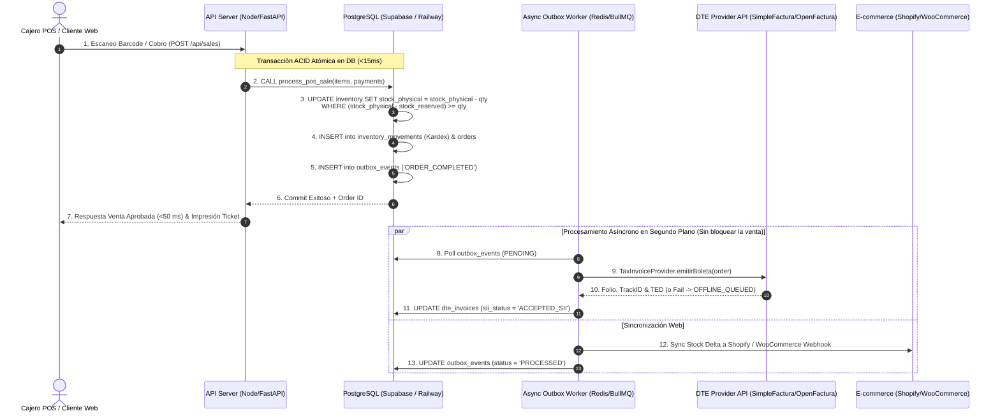

# Arquitectura Definitiva y Diseño de Base de Datos para POS Omnicanal & DTE Chile

Este documento detalla la arquitectura de software, modelado de base de datos y estrategias de ingeniería para un sistema de Punto de Venta (POS) ultrarrápido (<50 ms de latencia) con sincronización de inventario omnicanal en tiempo real y Facturación Electrónica DTE para Chile.

---

## Diagrama del Flujo de Venta Omnicanal y Facturación DTE



---

## 1. Modelado de Datos Relacional (PostgreSQL DDL)

El esquema relacional completo se encuentra disponible y listo para ejecutar en el archivo [`schema.sql`](file:///c:/Users/emili/OneDrive/Documentos/yeymi/Synco/schema.sql).

### Principales aspectos de diseño del esquema:
* **Llaves Primarias UUID**: `gen_random_uuid()` para independencia absoluta entre entornos de desarrollo y producción sin colisión de secuencia.
* **Tipos de Datos Estrictos**: Montos monetarios con `NUMERIC(14,2)` y `NUMERIC(14,4)` (pesos netos y brutos), evitando problemas de redondeo de punto flotante.
* **IVA Chile 19%**: Validación de tasa `vat_rate` y restricción `CHECK (gross_price >= net_price)`.
* **Kardex Inmutable**: Registro histórico cronológico en `inventory_movements` (entradas, salidas, mermas, ventas POS, ventas Web, bloqueos de reserva).
* **Control de Cajas y Turnos**: `cash_registers` y `cash_register_shifts` para aperturas, cierres y cuadraturas con cálculo explícito de diferencias.
* **Tracking DTE**: Registros de folios CAF (`dte_caf`) y estado de documentos ante el SII (`dte_invoices`).

---

## 2. Control de Concurrencia e Inventario "Incansable"

### ¿Por qué `UPDATE ... WHERE` Atómico supera a `SELECT ... FOR UPDATE`?

| Criterio | `SELECT ... FOR UPDATE` | `UPDATE ... WHERE ...` (Propuesto) |
| :--- | :--- | :--- |
| **Tiempo de Bloqueo** | Bloquea la fila durante **toda** la transacción del servidor web (múltiples ms/segundos). | Bloquea la fila durante **microsegundos** a nivel de motor de PostgreSQL. |
| **Riesgo de Deadlock** | Elevado si múltiples conexiones bloquean productos en distinto orden. | **Cero (0)** riesgo de Deadlock en deducción simple. |
| **Escalabilidad** | Deficiente bajo alta concurrencia (ej. CyberDay / Venta masiva). | Máxima concurrencia admitida por el motor PostgreSQL. |
| **Garantía Integridad** | Requiere lógica explícita en app. | Forzada por la DB mediante restricción `CHECK (stock_physical >= 0)`. |

### Operación SQL Atómica Clave
```sql
UPDATE inventory 
SET stock_physical = stock_physical - v_qty,
    updated_at = NOW()
WHERE warehouse_id = p_warehouse_id 
  AND variant_id = v_variant_id 
  AND (stock_physical - stock_reserved) >= v_qty;
```
Si el resultado de `ROW_COUNT` es `0`, significa que otra caja o cliente web compró la última unidad una fracción de milisegundo antes, abortando la transacción limpiamente mediante un `RAISE EXCEPTION`.

### Gestión de Carritos Abandonados en Web (Reservas Temporales)
1. Al agregar un ítem al carrito e-commerce, se invoca `reserve_web_cart_stock(...)`, incrementando `stock_reserved` por 15 minutos (TTL).
2. Si el pago es exitoso, la reserva se liquida y el stock físico se descuenta.
3. Si el usuario abandona el carrito o el pago falla, la función `release_expired_inventory_reservations()` (ejecutada mediante `pg_cron` o worker de segundo plano cada 60 segundos) libera `stock_reserved` atómicamente.

---

## 3. Rendimiento, Índices y Caché (<50 ms Latencia)

### Estrategia de Índices Composite & Trigram
1. **Escaneo Ultra Rápido (<5 ms)**: Índice Único B-Tree en `product_variants(barcode)` y `product_variants(sku)`.
2. **Búsqueda Predictiva en Caja**: Índices Trigram (`pg_trgm`) en `products(name)` y `product_variants(sku)` para autocompletado en caja mientras el cajero tipea.
3. **Kardex y Consultas de Stock**: Índices compuestos `inventory(warehouse_id, variant_id)` e `inventory_movements(variant_id, created_at DESC)`.

### Patrón Transactional Outbox (Desacoplamiento de Servicios Externos)
Para garantizar la respuesta de cobro en **<50 ms**:
* El cobro en caja física ejecuta únicamente la transacción de base de datos local y responde inmediatamente al cliente.
* La emisión de la Boleta ante el SII y el envío del webhook a Shopify/WooCommerce **NUNCA ocurren en la petición HTTP del cobro**.
* Se registra un evento en `outbox_events` dentro de la misma transacción de la venta. Un worker asíncrono en segundo plano consume los eventos y los reintenta de forma transparente.

### Configuración de Pooling de Conexiones (PgBouncer)
* **Modo de Pooling**: `Transaction` (Liberación inmediata de la conexión en cada `COMMIT`).
* **Supabase Free Tier / Railway**:
  * Usar la URL de conexión del Pooler en el puerto `6543` para peticiones HTTP/API.
  * Usar la URL Directa en el puerto `5432` únicamente para migraciones de esquema DDL.
* **Cálculo de Conexiones del Pooler**:
  $$\text{Pool Size} = (\text{Core Count} \times 2) + \text{Spindle Count}$$
  En Supabase Free Tier o VPS pequeño (2 vCPU), `default_pool_size = 20` a nivel de servidor soporta más de 1,000 conexiones concurrentes de la aplicación cliente a través de PgBouncer sin caer en error `Too many connections`.

---

## 4. Capa de Abstracción para DTE (Chile - SII)

La capa de abstracción se implementa mediante el patrón **Adapter** en TypeScript ([`dte_adapter.ts`](file:///c:/Users/emili/OneDrive/Documentos/yeymi/Synco/dte_adapter.ts)).

### Tolerancia a Fallos y Estrategia Offline-First / Caídas del SII
1. **Reserva Local de Folios CAF**: El sistema almacena localmente los archivos CAF autorizados por el SII en `dte_caf`.
2. **Impresión Inmediata en Contingencia**: Si la API externa del proveedor DTE (SimpleFactura, OpenFactura) o el SII responde con Timeout (>3000 ms) o error 5xx:
   * La venta en el POS **NUNCA SE CANCELA**.
   * El estado del documento se guarda como `OFFLINE_QUEUED`.
   * Se imprime el ticket físico con el folio CAF pre-asignado localmente.
   * El worker asíncrono reintenta el envío del XML firmado al SII en segundo plano con backoff exponencial.
