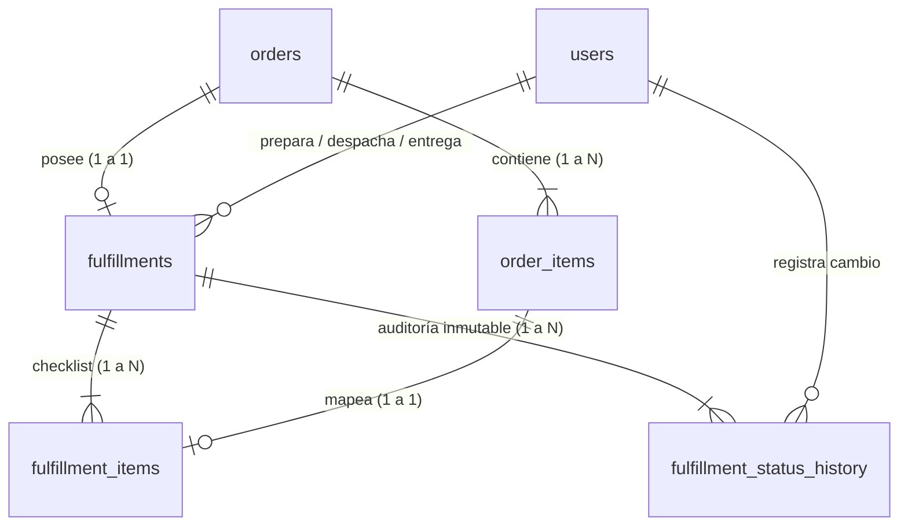

# Arquitectura del Módulo de Fulfillment & Despachos

## Propósito del Módulo
El módulo de Fulfillment administra el ciclo de vida operativo completo del procesamiento físico de pedidos en Synco POS, cubriendo tanto los **Despachos a Domicilio (DISPATCH)** como los **Retiros en Local (PICKUP)**.

Desacopla la venta financiera inalterable (`orders`, `order_items`) de la logística operativa en bodega y ruta (`fulfillments`, `fulfillment_items`), garantizando trazabilidad absoluta de tiempos y usuarios responsables.

---

## Diagrama de Relación Entidad-Componente

---

## Máquina de Estados

### Despacho a Domicilio (`DISPATCH`)
`PENDING` ➔ `PREPARING` ➔ `PREPARED` ➔ `IN_TRANSIT` ➔ `DELIVERED`

### Retiro en Local (`PICKUP`)
`PENDING` ➔ `PREPARING` ➔ `PREPARED` ➔ `PICKED_UP`

*   **`PENDING`**: Pedido ingresado, en espera de inicio de alistamiento.
*   **`PREPARING`**: Alistamiento iniciado por un operario (inicia el cronómetro de preparación).
*   **`PREPARED`**: 100% del checklist de preparación validado. Paquete listo en zona de despacho o mostrador.
*   **`IN_TRANSIT`**: El repartidor toma la orden y sale a ruta ("Salir a ruta").
*   **`DELIVERED`**: Entregado en domicilio con checklist final de entrega, cobro COD (si aplica) y firma/foto.
*   **`PICKED_UP`**: Cliente retira en el mostrador del local con checklist final y firma digital.
*   **`CANCELLED`**: Cancelación administrativa con registro de motivo.
